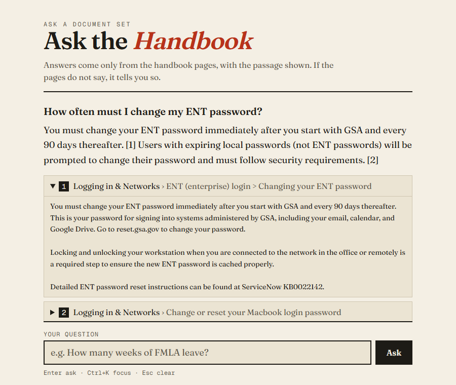
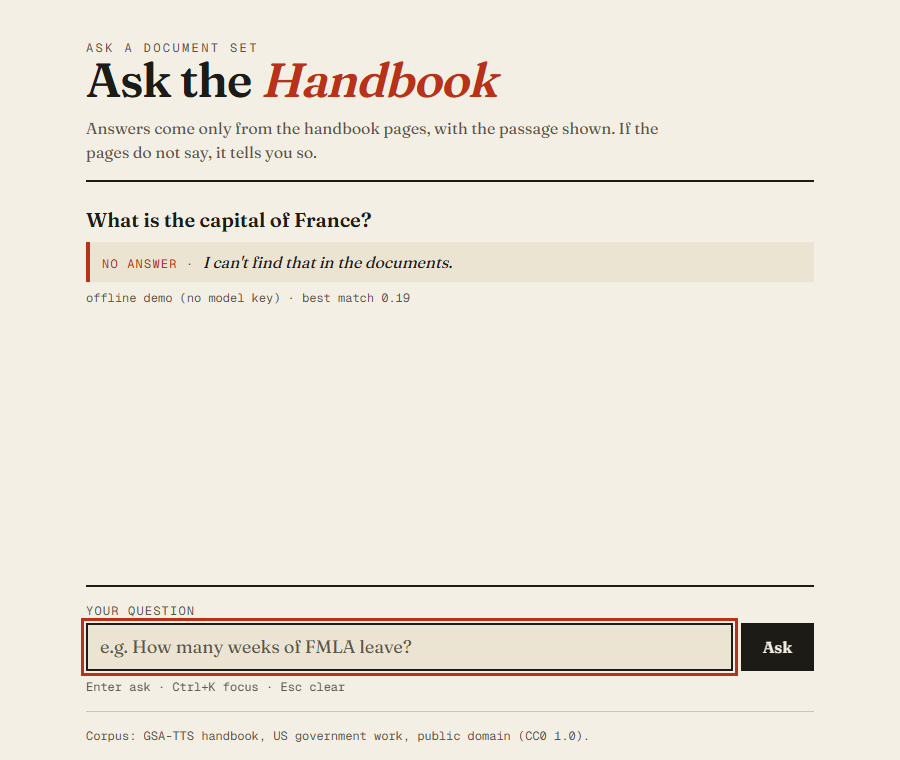
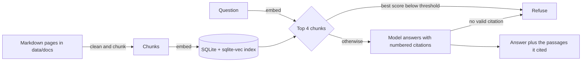

# Ask the Handbook

A small web app where you ask a question about a set of handbook pages and get a short answer with the passages it came from.

I built it to learn how retrieval-augmented generation fails. The part I cared about most is the refusal: when the pages don't cover a question, it says "I can't find that in the documents." and doesn't guess.





Both screenshots are from the app running locally in offline demo mode.

## Quick start

Needs Node 22.13 or newer.

```bash
git clone https://github.com/YazanAlshareef/handbook-rag-chatbot.git
cd handbook-rag-chatbot
npm install
npm run dev
```

Open http://localhost:3000. With no `.env.local` it runs in demo mode, which needs no key and no network.

**Not run with a live model key.** Everything in this README was run in demo mode. The Gemini code path follows the current `@google/genai` docs but I have never called it for real, and its refusal threshold is a guess until someone calibrates it.

## How it works



1. **Clean and chunk** (`lib/chunk.ts`). I strip front matter and template tags, keep the heading structure, then split by heading, paragraph and sentence. Chunks are at most 900 characters (about 200 tokens), with 150 characters of overlap inside a section. Chunks under 40 characters are dropped because they were link-only stubs like "See InSite page." I picked these sizes by reasoning, not by experiment.
2. **Embed** (`lib/llm.ts`). This is the only file that knows which model provider is in use. `LLM_PROVIDER` is `gemini` or `fixture`.
3. **Store** (`lib/store.ts`). SQLite with the `sqlite-vec` extension, through Node's built-in `node:sqlite`, using cosine distance.
4. **Retrieve and answer** (`lib/rag.ts`). The top 4 chunks go to the model. If the best score is under the threshold, the app refuses without calling the model. The model must cite passages as `[n]`, and the page shows only the passages the answer cites with a valid `[n]`. An empty answer, the refusal sentence, or an answer with no valid marker all count as a refusal, since I can't check that last kind against any passage.
5. **Serve** (`app/api/ask/route.ts`, `app/page.tsx`). A Next.js route and a chat page.

The model key stays on the server in `.env.local`, which git ignores. The browser never sees it.

## The documents

The corpus is 12 pages of the [GSA-TTS handbook](https://github.com/GSA-TTS/handbook): leave, FMLA, paid parental leave, overtime, logging in, PIV cards, equipment, Google Drive, privacy and a few more.

- Source: `GSA-TTS/handbook` at commit `c220f93896b39e9e4ab0f486a1d5bf346ac06e3e` (also in `data/docs/.source-commit`).
- Licence: a US government work, public domain in the US. The repo also carries CC0 1.0, and a copy is in `data/docs/LICENSE-CC0.md`.
- I cleaned the markdown (front matter, Jekyll tags, link syntax) and left the wording alone.

## Using Gemini

1. Copy `.env.example` to `.env.local`.
2. Set `LLM_PROVIDER=gemini` and `GEMINI_API_KEY`. The models come from `GEMINI_EMBED_MODEL` and `GEMINI_CHAT_MODEL`.
3. Build the index, which calls the embedding API: `npm run ingest`
4. Run `npm run dev`.
5. Run `npm run eval` and read the threshold sweep at the end. Set `RAG_MIN_SCORE` from that, not from my default of 0.6. The sweep uses only the 10 questions marked `"split": "tune"`. Read the "test split" numbers afterwards so the threshold isn't judged on the questions that chose it.

`data/index.gemini.db` is git-ignored. On Vercel you would set the same variables in the project settings and ship the built index.

Other commands:

```bash
npm run ask -- "How many weeks of FMLA?" --dry-run   # one question from the terminal
npm run ingest -- --dry-run                          # rebuild the offline index
npm run eval -- --dry-run                            # run the 40 eval questions
npm test                                             # 22 tests
npm run lint
npm run build
```

GitHub Actions runs lint, tests and build on every push (`.github/workflows/ci.yml`). It needs no secrets.

## Demo mode

`LLM_PROVIDER=fixture` is the default. It is a local stand-in: hashed word and word-pair vectors for retrieval, and an extractive answer that quotes the two best-matching sentences. The index is committed (`data/index.fixture.db`), so the demo and the tests work offline. The matching is lexical, so it misses paraphrases: "My dad passed away" does not find "bereavement". The page labels these answers "offline demo".

## Evaluation

`eval/questions.jsonl` has 40 questions, each with an expected source document and section. 24 are answerable, 8 are unanswerable (off-topic or not in the pages), and 8 are tricky: a paraphrase with no shared words, a false premise, a prompt-injection attempt, and a question where the pages only point to a calculator.

Each answerable question has `must_contain` phrases, the key fact. "Key fact in answer" means the answer contains all of them. "Cited" counts only passages the answer marked with a valid `[n]`. Ten questions are marked `tune` (for choosing the threshold) and the other 30 `test`.

This is the output of `npm run eval -- --dry-run` (offline mode, threshold 0.3):

| | all | test split |
|---|---|---|
| Should answer | 30 | 23 |
| Not refused | 27 | 20 |
| Key fact in answer | 19 | 13 |
| Expected source in top 4 | 22 / 30 | 17 / 23 |
| Expected source cited | 20 / 30 | 15 / 23 |
| Should refuse | 10 | 7 |
| Refused | 7 | 5 |

It's a weak result. The offline stand-in is lexical and extractive, so it sets a floor and says little about the Gemini setup. "Not refused" flatters it: only 19 of the 30 answerable questions contain the key fact. A few "expected source" misses are arguable, because the paid parental leave page and the leave page both cover parental leave. The key-fact phrases are short substrings I chose, so a correct answer worded differently counts as a miss. An AI coding assistant wrote the questions and key facts, I didn't curate them by hand, and nobody has run them against a live model.

## What broke

- **Test runner.** `vitest` failed to install because of a dependency conflict, so I used the built-in `node:test` through `tsx`.
- **First corpus.** I started with the GitLab handbook. Its licence was unclear and one page returned a 404, so I moved to the GSA-TTS handbook.
- **Stub chunks.** After stripping links, some chunks were just "See InSite page." and polluted retrieval. I added the 40-character minimum.
- **Threshold too low.** My first fixture threshold (0.2) let a World Cup question through at a score of 0.31. The eval sweep gave me 0.3.
- **`&amp;` in titles.** A citation showed "Logging in &amp; Networks". Titles are now decoded when parsed.
- **Windows file lock.** A running `next start` holds `data/index.fixture.db` open, so `npm run ingest` fails with `EPERM` until the server stops.
- **Next.js config.** This Next.js version rejects `runtime` and `dynamic` route exports when `cacheComponents` is on, so the route uses neither. `sqlite-vec` is a native extension, so I marked it as an external package and included the index files in the route's build output.
- **Demo suggestion.** One of the suggested questions on the page (parking policy) scored 0.303 against the 0.3 threshold, so the demo answered it instead of refusing. I replaced it with an off-topic question.
- **Retry and daily cap.** On review I found that the Gemini retry never retried a timeout (only 429 and 5xx), and that malformed requests used up the daily cap. Both are fixed and tested.

## How an AI coding assistant helped

An AI coding assistant wrote the first draft of the code, the 40 eval questions and these docs, working from a spec I gave it. I ran the commands and reviewed the files, and the draft was revised after review (citation handling, the request-size limit, the eval checks). The eval questions have not been checked against the handbook line by line.

## Limits

- Not run with a live key. Live answer quality, citation behaviour and the Gemini threshold are untested.
- Not deployed. I haven't tested the `sqlite-vec` binary on Vercel's Linux runtime.
- The rate limit is in memory, per server instance, and keyed on `x-forwarded-for`. On serverless each instance counts alone, and a caller can forge the header when no proxy sits in front. It slows abuse and does not stop it. A second cap, `RATE_LIMIT_PER_DAY` (default 500, also in memory per instance), limits total questions even when callers rotate the header.
- No conversation memory. Each question stands alone.
- Retrieval takes the top 4 chunks only, so a question that needs facts from many pages may get a partial answer.
- The corpus is a snapshot and will go stale as the upstream handbook changes.
- English only.

## Licence

Code: MIT (see `LICENSE`). Documents in `data/docs`: public domain and CC0 1.0 (see above).
