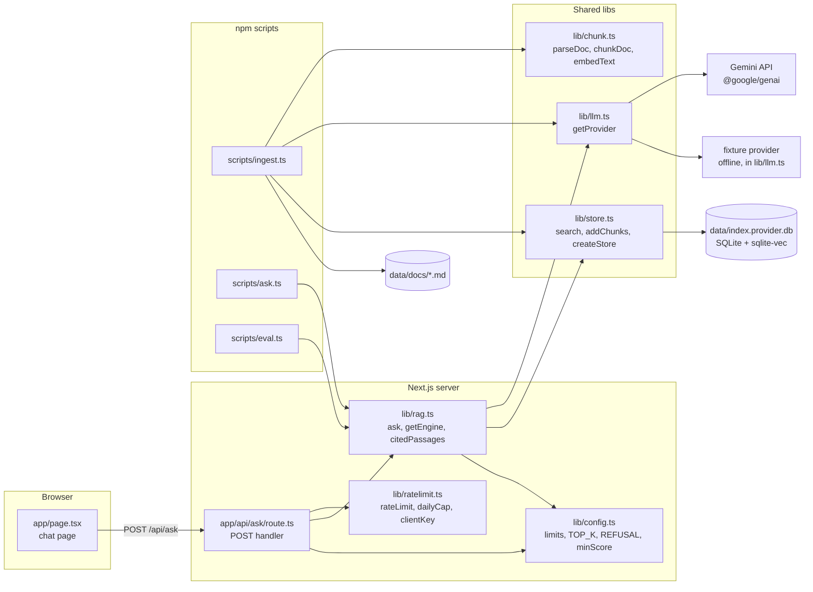

# Architecture

Components of the app and what each one calls. Arrows point from caller to callee.

Sources: [app/page.tsx](../../app/page.tsx), [app/api/ask/route.ts](../../app/api/ask/route.ts), [lib/rag.ts](../../lib/rag.ts), [lib/llm.ts](../../lib/llm.ts), [lib/store.ts](../../lib/store.ts), [lib/chunk.ts](../../lib/chunk.ts), [lib/ratelimit.ts](../../lib/ratelimit.ts), [lib/config.ts](../../lib/config.ts), [scripts/ingest.ts](../../scripts/ingest.ts), [scripts/ask.ts](../../scripts/ask.ts), [scripts/eval.ts](../../scripts/eval.ts).
