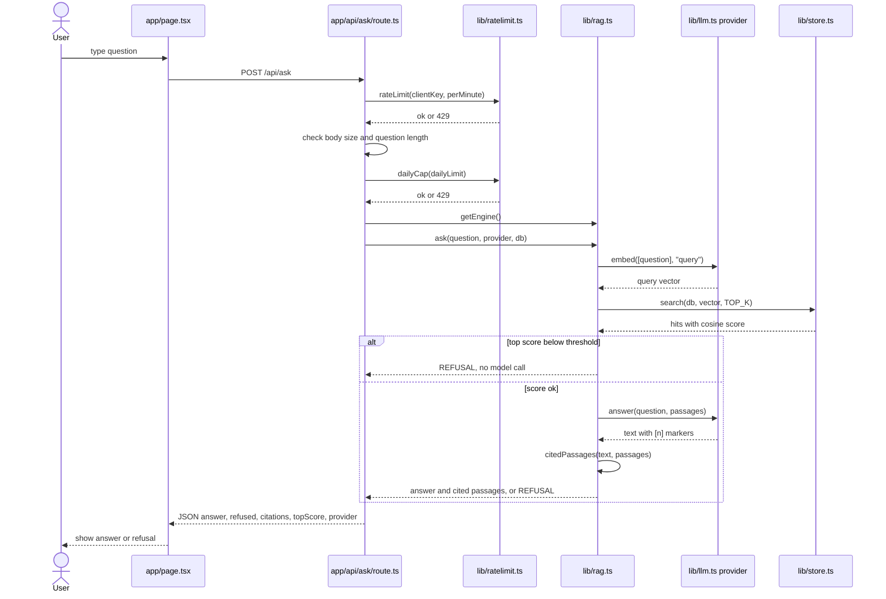
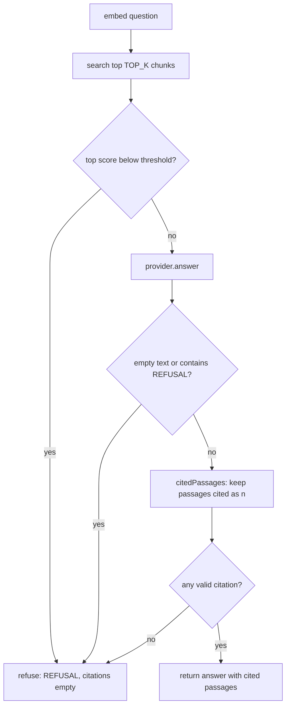

# Ask flow

## Request sequence

One question from the browser to an answer with citations, or a refusal.

## Decisions inside ask()

How `ask()` ends in an answer or a refusal.

The threshold comes from `minScore(provider.name)`: 0.3 for fixture, 0.6 for gemini, or `RAG_MIN_SCORE` if set.

Sources: [app/page.tsx](../../app/page.tsx), [app/api/ask/route.ts](../../app/api/ask/route.ts), [lib/rag.ts](../../lib/rag.ts), [lib/ratelimit.ts](../../lib/ratelimit.ts), [lib/config.ts](../../lib/config.ts), [lib/llm.ts](../../lib/llm.ts), [lib/store.ts](../../lib/store.ts).
