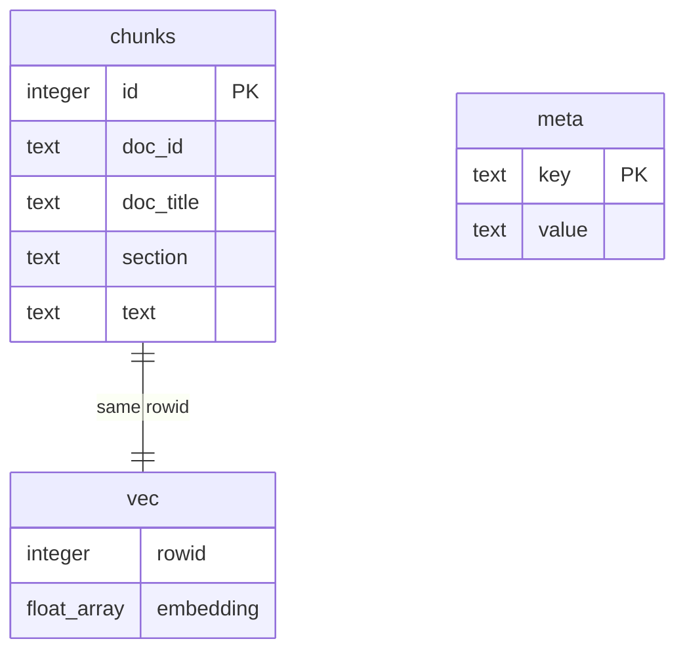

# Data model

The three tables in the SQLite index file. `vec` is a sqlite-vec `vec0` virtual table. Its rowid equals `chunks.id`. There is no declared foreign key.

`meta` holds the keys `provider` and `dim`. `getEngine()` checks them against the active provider before it serves questions. The embedding uses cosine distance.

Sources: [lib/store.ts](../../lib/store.ts), [lib/rag.ts](../../lib/rag.ts).
