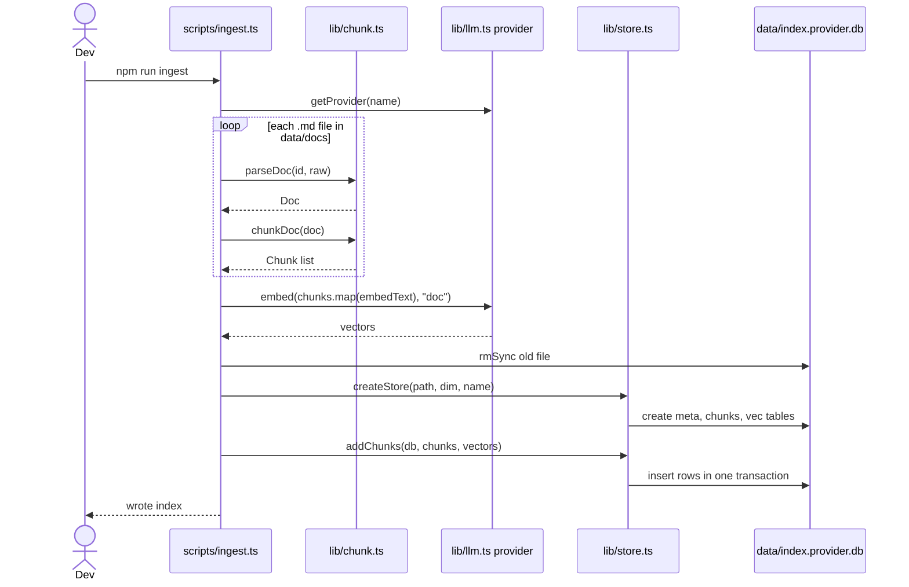

# Ingest flow

What `npm run ingest` does: read the pages, chunk them, embed them, and write a fresh index.

With `--dry-run` the script sets `LLM_PROVIDER=fixture` first. Files named `LICENSE*` are skipped.

Sources: [scripts/ingest.ts](../../scripts/ingest.ts), [lib/chunk.ts](../../lib/chunk.ts), [lib/llm.ts](../../lib/llm.ts), [lib/store.ts](../../lib/store.ts).
